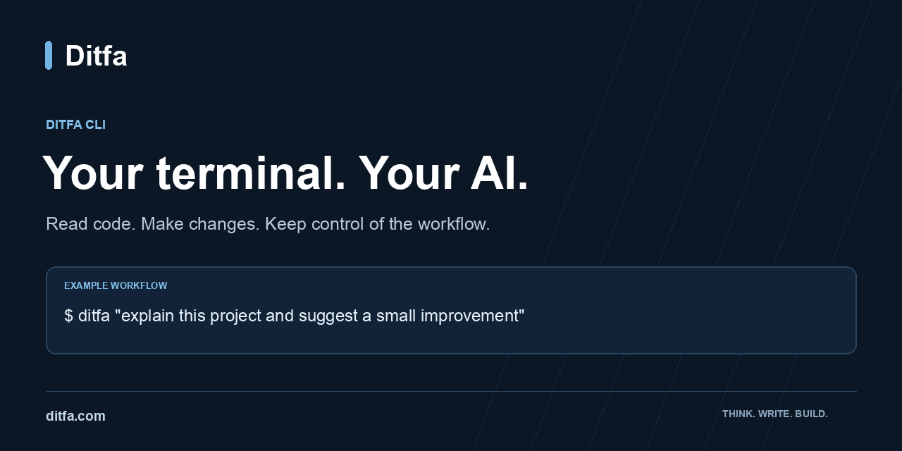

# Ditfa CLI

**An AI coding agent for your terminal, built in Rust.** Read a codebase, make reviewable edits and run commands with configurable sandbox and approval controls. Choose Ditfa, another supported model provider, or a local model.

[](https://github.com/ditfa-dev/ditfa-cli/actions/workflows/ci.yml)
[](https://github.com/ditfa-dev/ditfa-cli/releases/latest)
[](LICENSE)

[Website](https://ditfa.com) · [Downloads](https://ditfa.com/downloads#terminal) · [Getting started](docs/getting-started.md) · [Model providers](PROVIDERS.md) · [Discussions](https://github.com/ditfa-dev/ditfa-cli/discussions)

## Install

### macOS and Linux

Download the installer, review it, then run it:

```sh
curl -fsSL https://github.com/ditfa-dev/ditfa-cli/releases/latest/download/install.sh -o install.sh
# Review install.sh before running it.
sh install.sh
ditfa --version
```

### Windows PowerShell

```powershell
Invoke-WebRequest https://github.com/ditfa-dev/ditfa-cli/releases/latest/download/install.ps1 -OutFile install.ps1
# Review install.ps1 before running it.
& .\install.ps1
ditfa --version
```

### Package manager or manual download

The npm package is named [`ditfa`](https://www.npmjs.com/package/ditfa) and requires Node.js 18 or later. Install it with `bun add --global ditfa` or `npm install --global ditfa`.

Prefer native binaries? Download an archive and `SHA256SUMS` from the [latest release](https://github.com/ditfa-dev/ditfa-cli/releases/latest). Builds are available for macOS, Linux and Windows on x64 and arm64; availability can vary by release. The native installers verify the archive checksum. See [installation details](docs/install.md) for building from source.

## Start your first task

Create a key at [chat.ditfa.com/api-keys](https://chat.ditfa.com/api-keys), set it in your shell and open a project:

```sh
export DITFA_API_KEY="your-ditfa-api-key"
cd my-project
ditfa
```

In PowerShell, use `$env:DITFA_API_KEY = "your-ditfa-api-key"`. Keep your key out of source control. With a Ditfa key configured and no provider override, the CLI selects an available model for your account.

Try: **“Explain this project and suggest a small improvement.”** Review the proposed edits and command approvals before accepting changes.

For a task from a script:

```sh
ditfa exec "add unit tests for the parser and make them pass"
```

## Choose how you work

| Capability | What you can do |
| --- | --- |
| Code editing | Inspect files, propose patches and run project commands locally. |
| Model providers | Use Ditfa, OpenAI, Anthropic, Gemini, OpenRouter, DeepSeek or an OpenAI-compatible endpoint. |
| Local models | Connect Ollama, LM Studio or another compatible local server. |
| Execution controls | Configure sandbox access and command approval policies for your workflow. |
| Persistent sessions | Continue earlier work with `ditfa resume`. |
| MCP and skills | Connect tools through Model Context Protocol and add reusable workflows and `AGENTS.md` instructions. |
| Automation | Use `ditfa exec`, JSON output and output schemas in scripts. |
| Editor integration | Explore the [VS Code extension](ditfa-vscode) and [SDKs](sdk). |

### Bring a model provider

Set the provider's API key and select a model available to your account:

```sh
export ANTHROPIC_API_KEY="your-provider-api-key"
ditfa -c model_provider=anthropic -m YOUR_MODEL_ID

# Or connect a local Ollama server.
ditfa --oss --local-provider ollama
```

Provider and model support depend on the endpoint and account you use. See [PROVIDERS.md](PROVIDERS.md) for exact environment variables, wire protocols and custom endpoints.

## Documentation

| Guide | Start here for |
| --- | --- |
| [Getting started](docs/getting-started.md) | Your first session, common commands and setup checks |
| [Model providers](PROVIDERS.md) | Hosted providers, API keys and local models |
| [Sandbox and approvals](docs/sandbox.md) | Execution boundaries and safer workflows |
| [Configuration](docs/config.md) | Configuration entry points |
| [Contributing](CONTRIBUTING.md) | Development setup and pull requests |
| [Security policy](SECURITY.md) | Private vulnerability reporting |

## Build and contribute

Install Rust through rustup; the repository pins its toolchain in `ditfa-rs/rust-toolchain.toml`.

```sh
git clone https://github.com/ditfa-dev/ditfa-cli.git
cd ditfa-cli/ditfa-rs
cargo build --release --bin ditfa
./target/release/ditfa --version
```

The Rust workspace is large. Use `cargo build -j 2` to limit parallel compilation on smaller machines. Read [CONTRIBUTING.md](CONTRIBUTING.md) before opening a pull request.

## Help and feedback

- **Questions and ideas:** [GitHub Discussions](https://github.com/ditfa-dev/ditfa-cli/discussions).
- **Reproducible bugs:** [open an issue](https://github.com/ditfa-dev/ditfa-cli/issues/new/choose), including your version, operating system and reproduction steps. Remove keys, private code and personal information from logs.
- **Security vulnerabilities:** use [private reporting](https://github.com/ditfa-dev/ditfa-cli/security/advisories/new), as described in [SECURITY.md](SECURITY.md).
- **Desktop downloads:** visit [ditfa-releases](https://github.com/ditfa-dev/ditfa-releases).

## License and attribution

Ditfa CLI is licensed under [Apache-2.0](LICENSE). It is derived from an Apache-2.0 project by OpenAI. See [NOTICE](NOTICE) for attribution. Third-party model names and trademarks belong to their respective owners.
