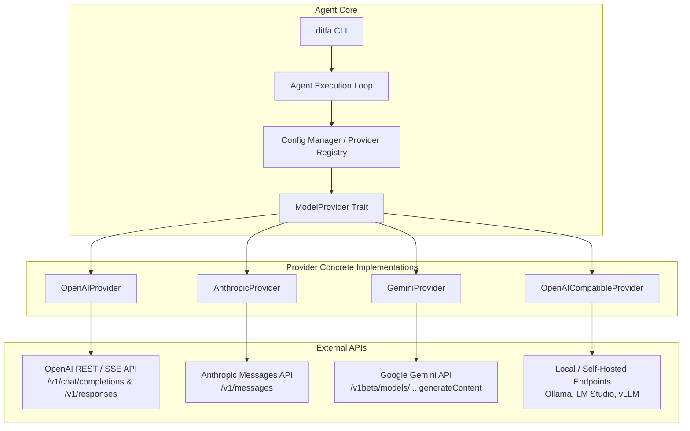

# Ditfa Refactor Plan: Discovery & Inventory Mapping

## Executive Summary
This document serves as the discovery report and refactoring roadmap for transforming `openai/codex` (`ditfa-rs`) into **Ditfa**: an open, multi-provider AI coding CLI agent supporting OpenAI, Anthropic, Google Gemini, and local/self-hosted LLM endpoints (Ollama, LM Studio, vLLM).

---

## 1. Crate & Package Inventory

The repository is structured as a Rust cargo workspace (`ditfa-rs`), alongside Node.js packaging (`codex-cli`), SDK components (`sdk`), build definitions (`BUILD.bazel`, `flake.nix`, `justfile`), and documentation.

### Core Cargo Workspace Crates (`ditfa-rs/`)

| Crate Name | Primary Responsibility |
| :--- | :--- |
| `cli` | Main entry point for the binary (`codex` / `ditfa`), handles command-line argument parsing, subcommand dispatching (`config`, `login`, `exec`), and startup initialization. |
| `core` | Agent lifecycle management, loop processing, context fragment assembly, prompt construction, dynamic tool invocation, approval prompt management. |
| `model-provider` | Provider trait interface (`ModelProvider`), authentication provider resolution, account state, and capability flags. |
| `model-provider-info` | Serialized provider metadata (`ModelProviderInfo`), default built-in provider configurations, base URL resolution, and environment variable mapping. |
| `models-manager` | Dynamic model catalogs, context limits, token parameters, model metadata fetching and caching. |
| `codex-api` | HTTP & WebSocket network client, endpoint definition (`/v1/responses`, `/v1/chat/completions`), SSE stream parser, error mapping. |
| `codex-client` | Client interface wrapper consuming `codex-api` for session interaction. |
| `login` | Authentication flows (`CodexAuth`), OAuth PKCE, API key management, token storage (`auth.json`). |
| `protocol` | Standardized data types, JSON RPC schemas, event definitions, configuration models (`config.toml`), account state representations. |
| `config` | Configuration file loader (`~/.codex/config.toml`), profile manager, environment variable reader (`CODEX_*`). |
| `tui` | Terminal UI rendering using `ratatui` and `crossterm`, event handling, live streaming representation. |
| `sandboxing` | Cross-platform sandbox abstraction layer (Linux bubblewrap, macOS sandbox, Windows sandbox). |
| `linux-sandbox` & `bwrap` | Unprivileged sandbox runtime execution for Linux environment command execution. |
| `exec`, `exec-server`, `execpolicy` | Subprocess execution engine, PTY stream handling, approval policy enforcement. |
| `plugin`, `rmcp-client`, `codex-mcp` | Model Context Protocol (MCP) tool integration, client protocol implementations, plugin loading. |
| `core-plugins` & `core-skills` | Built-in system tools (file system, search, bash execution, web search). |
| `prompts` | System prompt templates, instruction formatting, variable replacement. |
| `analytics` & `otel` | Telemetry, metric gathering, and OpenTelemetry trace emission. |

### Non-Rust Packages
- **`codex-cli`**: Node.js/NPM package wrapper facilitating `npx codex` / `npx ditfa` execution.
- **`sdk`**: Client SDK for embedding or programmatically invoking the agent core.
- **`docs`**: Technical documentation and user guides.

---

## 2. OpenAI-Specific API Client Mapping

Currently, the model communication layer is closely coupled to OpenAI's API specs:

1. **Endpoint Specs (`codex-api/src/endpoint/`)**:
   - `responses.rs`: Implements OpenAI's `/v1/responses` API endpoint.
   - `responses_websocket.rs`: Implements real-time WebSocket protocol for `/v1/responses`.
   - `models.rs`: Model catalog fetching from `/v1/models`.

2. **Request / Response Schemas (`codex-api/src/requests/` & `codex-protocol`)**:
   - OpenAI message formats (`role`: `system`, `user`, `assistant`, `tool`).
   - Tool definition structure (`type`: `"function"`, `function`: `{ name, description, parameters }`).
   - Tool call output structure (`tool_call_id`, `output`).

3. **Streaming & Event Parsing (`codex-api/src/sse/`)**:
   - SSE stream event handlers expecting OpenAI delta events (`response.output_item.added`, `response.content_part.delta`, `response.completed`).

4. **Authentication (`login/` & `model-provider/src/auth.rs`)**:
   - Authentication defaults to `CODEX_API_KEY` or ChatGPT OAuth tokens with OpenAI actor header (`x-openai-actor-authorization`).

---

## 3. Identifiers to Rebrand (`codex` -> `ditfa`)

| Category | Existing Identifier | Target New Identifier |
| :--- | :--- | :--- |
| Binary / Executable | `codex` | `ditfa` |
| Config Directory | `~/.codex` | `~/.ditfa` |
| Primary Environment Variables | `CODEX_HOME`, `CODEX_API_KEY`, `CODEX_CONFIG`, `CODEX_LOG` | `DITFA_HOME`, `DITFA_API_KEY`, `DITFA_CONFIG`, `DITFA_LOG` |
| Cargo Workspace Crates | `codex-api`, `codex-client`, `codex-mcp`, `codex-home`, etc. | `ditfa-api`, `ditfa-client`, `ditfa-mcp`, `ditfa-home`, etc. |
| NPM Package | `@openai/codex` / `codex` | `@ditfa/cli` / `ditfa` |
| Built-in Config File | `codex.toml` | `ditfa.toml` |
| Telemetry Events | `codex.*` | `ditfa.*` |

---

## 4. Agent Architecture & Subsystems

1. **Tool Execution & Sandboxing**:
   - Tools are registered through `plugin` and `core-plugins`.
   - Execution passes through `execpolicy` to verify user approval presets.
   - Command runs inside platform sandboxes (`sandboxing`, `linux-sandbox`, `bwrap`).

2. **Session & Context Management**:
   - `core/src/session.rs` manages conversation turns, active context fragments, and token budget calculations.
   - History is persisted via `message-history` and `thread-store`.

3. **Permissions System**:
   - `utils/approval-presets` defines strict, lenient, or auto-approval rules for command execution.

---

## 5. Multi-Provider Architecture & Trait Abstraction

To support OpenAI, Anthropic, Google Gemini, and OpenAI-compatible local models (Ollama, LM Studio), we design a unified `ProviderClient` / `ModelProvider` abstraction layer:



### Proposed Interface Structure (Rust)

```rust
pub trait ModelProviderClient: Send + Sync + fmt::Debug {
    /// Returns provider identifier (e.g., "openai", "anthropic", "gemini", "ollama")
    fn provider_id(&self) -> &str;

    /// Resolves authentication headers or parameters for outgoing requests
    fn build_auth_headers(&self) -> Result<HeaderMap, ProviderError>;

    /// Translates internal prompt/context into provider-specific JSON request payload
    fn format_request(&self, request: &InternalChatRequest) -> Result<serde_json::Value, ProviderError>;

    /// Parses incoming streaming chunk into normalized internal stream event
    fn parse_stream_chunk(&self, chunk: &str) -> Result<Vec<InternalStreamEvent>, ProviderError>;

    /// Normalizes provider tool definitions from internal tool declarations
    fn format_tools(&self, tools: &[InternalToolSpec]) -> Result<serde_json::Value, ProviderError>;
}
```

---

## 6. Execution Roadmap

1. **Step 1**: Complete Discovery & Mapping (this document `REFACTOR_PLAN.md`).
2. **Step 2**: Implement Provider Abstraction Layer & Concrete Providers (OpenAI, Anthropic, Gemini, OpenAICompatible).
3. **Step 3**: Execute full Rebranding (`codex` -> `ditfa`) across build scripts, Cargo manifest files, paths, env vars, and documentation.
4. **Step 4**: Retain core sandboxing, session persistence, and permission workflows.
5. **Step 5**: Testing, unit tests for all providers, end-to-end integration tests, and build validation (`cargo build --release`).
6. **Step 6**: Finalize documentation (`README.md`, `PROVIDERS.md`).
